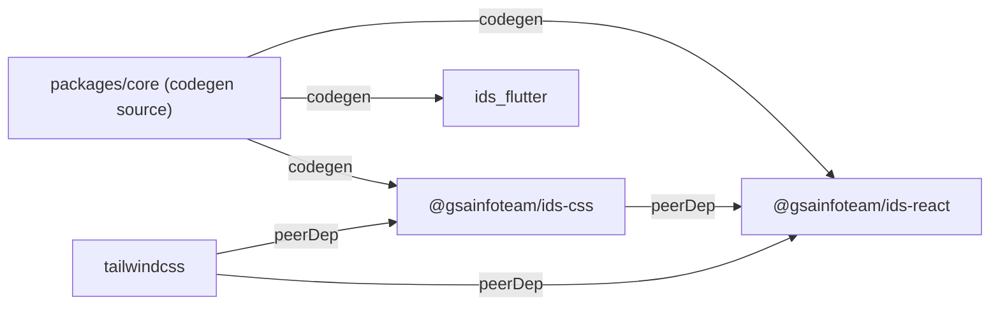

# IDS Agent Rules

## Repo structure

Monorepo (`gsainfoteam/ids`). pnpm workspace + Turborepo.

```
packages/
  core/     tokens + Style Dictionary codegen. Private — not published.
  css/      @gsainfoteam/ids-css GitHub Packages npm package. CSS variables + Tailwind @theme.
  react/    @gsainfoteam/ids-react GitHub Packages npm package. React components + IdsProvider.
  flutter/  ids_flutter pub.dev package (publisher: gistory.me). Flutter components + IdsProvider.
examples/
  next-app-router/  tanstack-start/  astro/   private apps that install IDS the way a consumer does.
```

The examples are the install guide the React README points to. CI builds them and
`scripts/check-examples.mjs` checks that the server-rendered HTML holds IDS markup and that the
stylesheet holds a class only `@source` on `ids-react/dist` produces. Changesets ignores them.

## Generated files — do not edit manually

These files are written by `pnpm codegen` (Style Dictionary, message generation and the font copy). Edits will be overwritten.

- `packages/css/dist/ids.css`
- `packages/react/src/tokens/types.ts`
- `packages/react/src/tokens/palette-model.ts` and
  `packages/flutter/lib/tokens/ids_palette_model.dart` (`packages/core/palette-model.js`)
- `packages/react/src/tokens/component-tokens.ts` and
  `packages/flutter/lib/tokens/ids_component_tokens.dart` (`IdsComponentColors`,
  `IdsComponentShadows`), written from `packages/core/tokens/component.json` and `shadow.json`
- `packages/react/src/internal/messages-catalog.ts` and
  `packages/react/src/components/form/editor/messages-catalog.ts` (the `editor` group, kept out of the
  shared catalog every component loads)
- `packages/react/messages/en.json`
- `packages/flutter/lib/tokens/*.dart`, including `ids_color_roles.dart` (`IdsColors`, written from
  `packages/core/color-roles.json`)
- `packages/flutter/lib/messages/ids_messages.dart`
- `packages/flutter/messages/ko.i18n.json`
- `packages/flutter/fonts/*` (`packages/core/fonts.build.mjs` copies them from the `pretendard-gov` and
  `geist` npm packages, so the Flutter fonts move with the versions in `packages/core/package.json`)

To change tokens: edit files under `packages/core/tokens/`, then run `pnpm codegen`.

## Common commands

```bash
pnpm codegen          # Run Style Dictionary: core → css/react/flutter
pnpm build            # Build all packages (turbo, css before react)
pnpm typecheck        # TypeScript check all packages
pnpm lint             # ESLint all packages
pnpm test             # Build, then Vitest: browser tests, every story's play, SSR and hydration of every story, dist checks
pnpm test:visual      # Compare every Gallery, light and dark, with the baselines, in the Playwright Linux image (Docker)
pnpm test:visual:update  # Render the Gallery baselines again in that image and write them to tests/__screenshots__
pnpm examples:build   # Build the Next.js, TanStack Start and Astro examples
pnpm examples:check   # Check their server-rendered HTML and CSS for IDS
pnpm size             # Gzip size of Button, Dialog, Select and the whole ids-react entry against .size-limit.json
pnpm storybook        # Storybook for ids-react (port 6006)
```

## Package responsibilities

**core** — Token source of truth. `sd.config.js` defines all formatters. Output goes directly to sibling packages. No build artifact. `pnpm build` in core = `style-dictionary build`.

**css** — Pure CSS package. No React dependency. Consumers import `@gsainfoteam/ids-css` and add Tailwind themselves (peerDep). Do not `@import "tailwindcss"` inside this package.

**react** — Component library. Library build via Vite, ESM only (`dist/index.js`; `@tanstack/hotkeys` ships no CommonJS), one module per source file (`preserveModules`, `sideEffects: false`); every entry in `dependencies` and `peerDependencies` stays external. Storybook for development.

**Bundle budget.** `packages/react/.size-limit.json` holds the gzip size an app pays for
`import { Button }`, `{ Dialog }`, `{ Select }` and every export, with React and the peers left
out, and CI fails past it (`pnpm size`). A limit sits 10 to 15% above the size measured when it was
set. When a change grows a size for a reason, raise that limit in the same commit and say why; a
single import growing towards the whole package means tree-shaking broke (a module with a side
effect at the top, or a part pulled in through a barrel). Code a component loads with `import()`
(Image's viewer) is budgeted twice: the import with `"entry": ["index"]`, which counts the entry
chunk and its static imports but not the chunk `import()` loads, and the import with that chunk.

**`'use client'` marks the modules that run on the client.** The build keeps one module per source
file, so each file's directive reaches `dist` (`rollup-preserve-directives`). A module that calls a
hook, creates a context or renders a component starts with `'use client'`; pure modules (`style.ts`,
logic such as `date.ts` or `number-step.ts`, types, DOM helpers and stores that client modules
call) and re-export-only `index.ts` files do not. This is what lets a Server Component import IDS
and render it without a boundary of its own. Every component index is server-safe for the same
reason: a Server Component cannot read a property of a client reference, so `<Dialog.Trigger>` and
`Button.Style()` work only when `Dialog` and `Button` themselves are plain server functions. Each
`components/<category>/<name>/index.tsx` holds no directive, no hook and no context; `Dialog` there
only renders `DialogRoot` from `root.tsx`, `Style` comes from a pure `style.ts`, and the namespace
aliases parts imported from their own client files. A part is recognised by
`elementTypeOf(child) === SelectItem`, never `child.type`: an element a Server Component hands over
arrives with a `react.lazy` wrapper as its type, which `elementTypeOf` (`utils/children.ts`) unwraps.
A root that recognises another component also accepts that component's root
(`[Avatar, AvatarRoot]`), since a Server Component hands over `<Avatar>` already rendered to
`<AvatarRoot>`. Storybook reads the props table from the
root (`docsReadFromTheRoot` in `.storybook/main.ts`), because the wrapper has no destructured
defaults to read. `tests/use-client.test.ts` checks both directions, and
`tests/server-components.test.ts` renders components, parts and `Style` from a Server Component.
`RichText` (`typography/rich-text`) is the one component rendered only on the server: its
`index.tsx` and `render.tsx` parse and draw the document with no client root, so a Server Component
sends IDS components and no Tiptap. `tests/use-client.test.ts` lists them in
`RENDERED_ONLY_ON_THE_SERVER`.

**What we build and what we install.** Prefer a well-maintained package over hand-rolled logic:

- Generic helpers come from `es-toolkit` (`clamp`, `isEqual`, `noop`, `debounce`, `uniq`, ...), never a local copy.
- Classes are merged by `cn` (the package, in place of `clsx` + `tailwind-merge`). `utils/cn.ts` only adds the IDS config, and `utils/tv.ts` runs the lite build of `tailwind-variants` through the same `cn`, so one engine resolves every conflict.
- Utility engines are installed, not written:
  - overlay positioning and interactions `@floating-ui/react` (hover intent, list navigation,
    typeahead, menu trees, modal focus, delay groups), used only through `internal/overlay`;
  - focus order `tabbable`, scroll lock `react-remove-scroll`;
  - dates `@internationalized/date`, numbers `@internationalized/number`, colors `culori`;
  - decimal arithmetic `decimal.js`, so a step of `0.1` lands on `0.3` and not `0.30000000000000004`;
    only the step rules themselves (snap up, down or to the nearest grid value) are IDS's code;
  - textarea sizing `react-textarea-autosize`, phone numbers `libphonenumber-js`;
  - QR code matrices `uqr`, which QRCode draws as its own SVG;
  - keyboard shortcuts `@tanstack/react-hotkeys`;
  - split panel layout (sizes, limits, collapse) `@zag-js/splitter` through `@zag-js/react`, headless
    prop getters on elements Splitter renders itself;
  - table state (sorting, row selection, pagination, column sizing) `@tanstack/react-table`, with
    its server-safe helpers imported from `@tanstack/table-core`;
  - slide dragging, snapping and auto-advance `embla-carousel` 8.6 (`embla-carousel-react`,
    `-autoplay`, `-auto-scroll`), wrapped only by `internal/slides`; Carousel adds the plugins.
  - charts `recharts` 3, an optional peer imported only by the `@gsainfoteam/ids-react/chart`
    entry, so an app without charts never installs it. Chart sizes, colors and labels the Recharts
    chart the app writes; Tooltip, Legend and the screen reader table are IDS's code.
  - rich text editing `@tiptap/*` 3 (MIT parts only: core, react, pm, starter-kit, extensions,
    markdown), imported only by the `@gsainfoteam/ids-react/editor` entry. Only
    `editor/engine.tsx` imports it at runtime, and `load-engine.ts` loads that with `import()`
    when an Editor mounts; Markdown goes through `@tiptap/markdown`, loaded the same way only for
    `format="markdown"`. The shell, toolbar and parts are IDS's code and use Tiptap's types only.
    The document schema (nodes, markdown rules, image and link checks) and the text styles live in
    `typography/rich-text`, which the `@gsainfoteam/ids-react/rich-text` entry renders on the
    server with `@tiptap/static-renderer`, mapping each block to an IDS component.
- Unstyled component packages are allowed only when they do not depend on Radix (for example `react-day-picker`). Radix, Base UI, cmdk and vaul are not used.
- Write it yourself only when no package fits IDS's API, or when wrapping one would keep most of the code anyway (OTPField: `input-otp` cannot take `register()`'s event `onChange`, form reset or partial-code validation). Written in-house for that reason:
  - the `overlay` and `toast` stores, on React's `useSyncExternalStore`. overlay-kit leaves a
    promise pending on unmount and throws on reopening an id, and zustand would replace only the
    subscribe glue;
  - Drawer gestures, ported from vaul, which is unmaintained and needs Radix Dialog;
  - toasts, ported from sonner, whose unlayered CSS beats Tailwind utilities and which sits outside
    the top layer.
  - ScrollArea, the overlay scrollbar. Radix ScrollArea (and shadcn's, built on it) is ruled out
    with Radix. OverlayScrollbars wraps the content in elements of its own, so it cannot make a
    `role="listbox"` element the scroller (the options' offset parent and `scrollTop` must stay on
    the listbox), cannot place a bar by where it is declared, and does not inset the bar ends from
    a rounded corner. What is left over native scrolling is a ResizeObserver and a thumb drag.
  - MessageScroller's follow and anchor engine. `@shadcn/react`'s message-scroller draws the
    scroller and the list as its own `<div>`s, so the ScrollArea viewport cannot be the scroller and
    the list cannot be an `<ol>` of `<li>`; it also puts a spacer `<div>` inside the list and has no
    release on text selection, `onReachStart` or new-message count.

**flutter** — Dart package. Platform directories (android/, ios/, etc.) intentionally absent — this is a package, not an app. Published to pub.dev via OIDC — no token.

## Code

**No comments.** Code carries no comments. When a line seems to need one, rename or restructure it
until it does not: a helper named for its reason (`tryCapturePointer`), a constant named for what
its value means, a condition split into named parts. Tool directives (`eslint-disable`,
`@ts-expect-error`, a `@deprecated` tag that editors strike through) are the only exception.
Explanations for users belong in the README and the story descriptions. Internal code
(`src/internal`, `src/hooks`, `src/utils`) explains itself to maintainers in a README.md in its
folder: what each module is, who uses it, how, and what breaks if it changes. A new internal module
adds its section there.

## React source layout

Components are grouped by the `유형` column of the Notion Components database. The folder is the
category, and the Storybook title is `<Category>/<Component>`.

```
packages/react/src/
  components/
    action/      Button, ButtonGroup, IconButton, IconToggle, Toggle, ToggleGroup, FloatingButton
    form/        Field and every *Field, Checkbox, Radio, Switch, Slider, Select, Rating, ...
    data/        Accordion, Avatar, Badge, Calendar, Card, Carousel, Chip, DataTable, Empty, Image,
                 Item, Marquee, QRCode, Table, TimePicker, ...
    feedback/    Alert, Progress, CircularProgress, Skeleton, Spinner, Toast
    layout/      AspectRatio, Divider, Spacer, ScrollArea, MessageScroller, Resizable, Splitter
    navigation/  Breadcrumb, Pagination, Stepper, Tabs
    overlay/     Dialog, Drawer, Menu, Popover, Tooltip
    typography/  Kbd, Label, Link
    utility/     Slot, Group, IdsProvider
  internal/      shared parts that are not exported:
                   surfaces     surfaces/ (control-surface, toggle-surface, icon-square,
                                field-surface, slider-surface), surface
                   fields       text-control (shell, Clear, useMergedRef), field-popup, list-styles,
                                temporal-field, form-value, date-locale
                   behaviour    pressable, state-props, use-checked-writes, icon-label, arc,
                                resize-handle, paragraph
                   feedback     status-palette
                   overlays     overlay (layer stack, top layer, presence, anchoring, modal layer)
                   slides       slides (Embla track, slide ARIA, drag cancel, keys, announcer)
                   strings      messages
  foundations/   token stories with no component, one folder each with a story and a README:
                 Color, Typography, Radius, InteractiveState
  overview/      stories that show IDS as a whole, first in the sidebar: Cover
  blocks/        screens built only from IDS components, several takes on each, one folder per
                 category with a story pair per take and a README
  hooks/ utils/ tokens/
```

A new component goes into the category Notion gives it. Code shared by several components but not
public goes into `internal/`, never loose at the root of `components/`.

**Component folder.** Every component keeps `index.tsx`, `root.tsx` and, when it has a `tv` Style,
`style.ts`. A component with parts, or a `root.tsx` past about 250 lines, is split further into one
file per part. Menu and Drawer show the shape:

```
drawer/
  index.tsx      Drawer and `export namespace Drawer`: types, part aliases, Style (server-safe)
  root.tsx       DrawerRoot: the root's state, context provider and markup ('use client')
  context.ts     createContext and the guard hook (useDrawerContext)
  style.ts       drawerStyle = tv({ slots, variants })
  trigger.tsx    DrawerTrigger, DrawerTriggerProps
  content.tsx    DrawerContent and the private popup it renders
  use-drawer.ts  logic hooks and pure helpers keep their own files
```

- `index.tsx` holds a hook-free root, `return <DrawerRoot {...props} />`, and the namespace only.
  The root's code, its helpers and any part the namespace used to define inline live in
  `root.tsx`; a `tv` Style lives in `style.ts`. A part is an alias with its props
  type beside it, so `Drawer.Trigger` and `Drawer.Trigger.Props` stay the public names:
  `export const Trigger = DrawerTrigger;` and
  `export namespace Trigger { export type Props = DrawerTriggerProps; }`. `Style` is
  `export const Style = drawerStyle;`.
- A part file is kebab-case (`item.tsx`, `item-indicator.tsx`) and exports `XPart` and
  `XPartProps`. A helper used by one part lives in that part's file; one shared by several parts
  gets a small file named for what it holds.
- Each public part sets its public name right after the function,
  `DrawerTrigger.displayName = 'Drawer.Trigger';`, so Show code prints `<Drawer.Trigger>` and not
  the function name. The icon-name lookup skips a `displayName` with a dot, so a part placed in an
  IconButton's `icon` never becomes its label.
- A sub-component with parts of its own keeps them under its own namespace (`Image.Viewer.Close`,
  not `Image.Close`). It is then a server-safe function in `index.tsx` that renders its client root
  (`Viewer.displayName = 'Image.Viewer'`), merged with a namespace of part aliases and types: a
  `const` alias cannot merge with a namespace that holds values, and a Server Component cannot
  read a part off a client reference. Its parts are `ImageViewerClose` with `displayName`
  `'Image.Viewer.Close'`. A client file cannot import that function without a cycle through
  `index.tsx`, so a component that picks the sub-component out of its children does so in its own
  server-safe `index.tsx`: `ImageGroup` finds `[Image.Viewer, ImageViewer]` and hands it to its
  client `ImageGroupRoot`.
- Parts and `root.tsx` import `./context`, `./style` and sibling parts directly. They import `'.'`
  only with `import type`, so no runtime cycle runs through `index.tsx`. The root recognises its parts
  (`elementTypeOf(child) === DrawerOverlay`, a set of part functions) by importing them, never
  through `Drawer.Overlay`.
- Paths imported from outside the folder (`field/context`, `select/select-options`,
  `calendar/date`, `drawer/drawer-gesture`) stay where they are.

## Stories

A component's `index.stories.tsx` holds three layers, in this order. The docs (the Docs page now,
MDX pages with `<Canvas of={Stories.X}>` later) are built from the first two; the third is for
tests and maintainers. ids_flutter's Widgetbook carries the same layers over to use cases
(`packages/flutter/RULES.md`), so a change to a layer here changes it there in the same commit.

1. **Basic**, first in the file and in exactly this order:
   - `Playground`: the root's props as controls, so a reader can try each value. Every Docs
     page opens with a live editor (see Live code), so a control Playground is not required to
     show every composition. Button, Select and Dialog go further, and a file may follow them:
     - `render` takes the args and writes the tree out, so Show code prints the exact
       composition the controls picked. It adds no `key` and no Fragment of its own: Show code
       prints a top-level `key` and every Fragment as `<React.Fragment>`. The one `key` is for a
       control that switches a prop the root reads only on mount (Select's `selectionMode`,
       whose value type changes with it): it remounts on that prop alone (`key="multiple"`). A
       value a mapping gives as several elements is an array.
     - A value a control cannot type (an icon, children, a set of parts, a `className`) is a
       string option `mapping`ed to the JSX or class (`leadingIcon: PlusIcon`, `items: groups`).
       Show code prints the names a reader writes (`<PlusIcon />`, not `React.forwardRef`).
     - An arg that goes to a part is named for the part (`titleText`, `fieldLabel`) and sits under
       that part's `table.category` (`Dialog.Content`).
     - `controls.include` leaves out what a control cannot set, and `if` shows a control only
       with the one it depends on (`href` with `asChild`). Callbacks stay `fn()`.
     - A `default*` prop takes effect on the next mount: the reader presses Remount. Storybook's
       `jsx.skip`, which would hide a remounting wrapper, prints the wrapper anyway (10.3.1).
   - `Usage`: the smallest real use, written inline in `render` with no `args` (a Select inside a
     `Field` with its label, a ButtonGroup of three buttons). It may carry a `play`. The Docs
     page's live editor starts from it, so it reads only names it can import (see Live code).
   - `Gallery`: **required.** Every variant, size and state on one screen, built from the
     `Showcase` kit so all galleries read alike. Import it as `~story-kit`.
2. **Examples**: one story per task a reader wants to do, named for that task
   (`ShowProgressWhileSaving`, `BuildASplitButton`, `GroupTogglesInAToolbar`; not `Loading`,
   `Separator` or `Mixed`). Each sets `parameters.docs.description.story`, which says what the
   reader gets and which props do it, and has a `play` when the behaviour can be asserted. An
   example that composes several components (ButtonGroup with ToggleGroup, Select in a react-hook-form
   `Field`) lives in the file of the component the reader came for, not in each one.
3. **Verification**: keyboard maps (`Keyboard`), right-to-left (`RightToLeft`), development
   warnings (`DevelopmentWarnings`), edge cases (`LongList`) and regression fixtures. Each carries
   `tags: ['verification']` and comes after every example. A description is optional.

```tsx
import { Showcase } from '~story-kit';

export const Playground: Story = {
  args: { children: '저장' },
};

export const Usage: Story = {
  render: () => <Button>저장</Button>,
};

export const Gallery: Story = {
  render: () => (
    <Showcase>
      <Showcase.Section title="Variant × Size">
        <Showcase.Matrix rows={sizes} columns={variants} render={(size, variant) => (
          <Button size={size} variant={variant}>{variant}</Button>
        )} />
      </Showcase.Section>
      <Showcase.Section title="States">
        <Showcase.Row label="disabled">...</Showcase.Row>
      </Showcase.Section>
    </Showcase>
  ),
};

export const SubmitAForm: Story = {
  render: function Render() { ... },
  parameters: { docs: { description: { story: '...' } } },
  play: async ({ canvas, userEvent }) => { ... },
};

export const DevelopmentWarnings: Story = {
  tags: ['verification'],
  render: function Render() { ... },
  play: async ({ canvas, userEvent }) => { ... },
};
```

**`'verification'` is the one marker.** `.storybook/main.ts` declares it with
`excludeFromDocsStories` and `defaultFilterSelection: 'exclude'`, so Storybook 10 leaves those
stories off the Docs page and hides them in the sidebar until a maintainer turns off the
verification exclusion in the sidebar's tag filter; a story URL still opens one directly. Do not use
`excludeFromSidebar`, which leaves no way to bring them back. Widgetbook has no tag filter, so
ids_flutter keeps its verification use cases in the `Checks` category, collapsed at start. A story
keeps the default `dev` and `test` tags, so `checkEveryStory`, the SSR, hydration and translation
checks run it like any other. A future MDX page shows only the stories
it names with `<Canvas of>` and never names a verification story. Do not use `'!autodocs'` or a
name prefix for this.

**`tests/story-layers.ssr.test.tsx` checks the layers** in every `src/components/**/*.stories.tsx`:
the basic three first and in order, examples before verification stories, a description on every
example, and the verification tag on every `Keyboard`, `RightToLeft` and `DevelopmentWarnings`
story. Blocks, foundations and the overview have rules of their own and are left out. A new story
file is checked from its first commit, so it starts on the layers. The files that predate the
layers sit in `NOT_YET_ON_THE_THREE_LAYERS`; a change that touches one moves it to the layers and
takes it off that list in the same commit. A listed file that already passes fails the test, so
the list only shrinks.

Declare the meta as `const meta = { ... } satisfies Meta<typeof X>` with `tags: ['autodocs']`, which
gives each component a Docs page (every story with Show code, plus the props table); foundation
stories opt out with `'!autodocs'`. Every story also has a Code tab beside the canvas. The global
decorator wraps every story in `IdsProvider`, so stories do not add their own theme or page
padding. A story that draws a whole page turns that padding off with
`parameters: { canvasPadding: false }`.

**Write the demo inline in `render`.** Show code and the Code tab are how a reader learns to
compose IDS, so a story file declares no demo component of its own: the IDS tree goes straight
into `render`, and a demo shared by several stories or Gallery rows is written out at each one.
A demo that needs state is `render: function Render() { ... }`, which holds the hooks and returns
the tree, named in PascalCase so the hooks lint accepts it. A `render` without `args` shows its own
source, hooks included. A `render` that takes `args` to forward a spy (`args.onValueChange`, or
`function Render(args)` when it also needs state) shows the rendered element tree instead: the
IDS elements appear, the hook code does not. The exceptions, which stay components:

- IdsProvider's `Readout`, `ModeSwitcher` and `SetColor`, which call `useTheme` and must render
  under a nested `IdsProvider`;
- Slot's `Tag`, since building an `asChild` component is that demo;
- custom SVG icons whose name automatic labelling reads (`BellIcon`, `PinIcon`, `ComposeIcon`);
- filler with no IDS in it (ScrollArea's `Text`, `Wide` and `Grid`, FloatingButton's
  `ContainingBlock`, Badge's `Box`, the foundation tables and specimens);
- the `Showcase` kit and decorators.

Plain helpers (play queries, data factories, formatters) stay at module level.

**Menu rows should start with one icon.** In stories, blocks and README examples, prefer giving
each `Menu.Item` and each submenu `Menu.Trigger` one leading heroicon (or an `Avatar` for a
person), so the labels line up. It is a recommendation, not a hard rule: a row may stay a label
alone when no icon fits it. The icon comes from the set the file already imports:
`@heroicons/react/16/solid` in component stories and READMEs, `24/outline` in blocks. A
`Menu.CheckboxItem` in a group of such items takes an icon too; a menu of only checkbox and radio
items stays bare, since their check or dot sits at the end and marks them already.

## Live code

Every component's Docs page opens with a live editor: the reader edits a module and sees it render
above the code. `.storybook/preview.tsx` sets `parameters.docs.page` to `LiveCodeDocsPage`, so a
story file adds nothing for it.

- **Editor.** `storybook-addon-code-editor` (Monaco, with Babel standalone evaluating the module),
  a devDependency used only by `.storybook`, so `dist` and `.size-limit.json` do not change.
  Monaco's files are served from `staticDirs` and load only when a Docs page opens. Storybook's
  addon panel is not used: it needs a `liveCodeEditor` parameter in every story file.
- **Starter code.** `live-code-docs.tsx` takes the first of these that becomes a module, and keeps
  it while the page stays open:
  1. the `Usage` story's Show code;
  2. the first story's Show code, which for an args `Playground` is the tree the controls drew;
  3. each example's source, in file order, verification stories left out.

  `live-module.ts` turns the code into `export default function Example()`: a JSX tree becomes its
  return value, and a `render` with no parameters becomes its body. It imports each free name
  from `@gsainfoteam/ids-react` (and its `chart`, `editor` and `rich-text` entries), `react`, the
  four `@heroicons/react` sets, `recharts` and `@internationalized/date`, in that order; the
  last two give only PascalCase names, so a story constant named `today` is not taken for the
  function of that name. A name found in none of them (module-level data, a demo component,
  `useForm`) rules that candidate out. A Docs page with no candidate left has no editor: today
  Calendar, DateField and DateTimeField (a module-level `today`), Field's zod page, Scheduler,
  Splitter and IdsProvider.

- **Usage is the starter.** Write `Usage` with literal values and imported names only, so the
  editor starts from the smallest real use. `tests/live-code.ssr.test.tsx` turns every `Usage`
  into its module and renders it on the server; one that reads a module-level name is skipped with
  that reason, and its Docs page starts from the next candidate.
- **Theme.** The preview renders inside the same `IdsStoryFrame` as the theme decorator, with the
  toolbar's globals read from the Docs context, so palette and mode apply.
- **Types.** `pnpm storybook` runs `tsc -p tsconfig.build.json` first, so Monaco reads
  `dist/**/*.d.ts`: completion lists prop values and a wrong one is an error. `recharts` and
  `@internationalized/date` are typed `any` in the editor.
- **Server-safe.** The addon reads `window` and the docs blocks read `document` when imported, so
  `live-code.tsx` loads the page through `lazy`, and the addon loads with `import()`. Story
  rendering does not change, so the SSR, hydration and translation checks are unaffected.
- **Tailwind.** The Docs page starts `@tailwindcss/browser` (pinned to the `tailwindcss` version)
  on `tailwindcss/theme.css`, `tailwindcss/utilities.css` and `@gsainfoteam/ids-css/no-fonts.css`,
  with no preflight, so a class the reader types (`w-[333px]`, `-rotate-2`) and an IDS utility the
  build never saw (`concentric-p-7`) both get CSS. It stays on until the page reloads and builds
  every class in the page again, in the same layers: on the Button, Select, Dialog and Card
  galleries, light and dark, no computed style changed.
- **Limits.** Edits live until the page reloads. A value Show code cannot print as code (a
  `CalendarDate` prints as `{2026-09-15}`) makes that candidate fail to parse.
- **Storybook only.** The live editor and the richer control Playground are Storybook's Docs
  page. ids_flutter's Widgetbook keeps its use case order (`packages/flutter/RULES.md`) and has
  no live editor, so a change here changes nothing there.

## Blocks

`src/blocks/<category>/` holds blocks: screens built only from IDS components, with several takes
on each (Login as a card, a split page, an email-only page, a QR code), the way shadcn/ui lists its
blocks. They are stories with a README, not exports: an app copies a block from the Code tab and
changes it.

- A take is two files. `<take>.stories.tsx` holds the `PC` story under `Blocks/<Category>/<Take>`
  with `globals: { viewport: { value: 'desktop' } }`. `<take>.mobile.stories.tsx` shows the same
  block as `Mobile` at the `mobile2` viewport: its meta spreads the PC meta and its story spreads
  the PC story (`{ ...pc.PC }`), so the code lives in one file and the spread keeps the PC story's
  Code tab. It writes `title` and `tags` out again, since Storybook reads both statically, and its
  file name sorts before the PC file, so Mobile comes first.
- The PC story sets `tags: ['!autodocs']` and `parameters: { canvasPadding: false }`, so the
  block fills the canvas.
- Every color, line, surface, corner and shadow comes from an IDS component. A block's own
  className lays out (flex, grid, gaps, padding, widths, alignment, `hidden md:flex`) and sets the
  IDS type scale on plain headings and paragraphs; it never sets a color, border, background,
  radius, shadow or `style`. A line is a `Divider`, a surface a `Card` or an `Item`, muted text a
  component's `Description` part. The classes a part documents (`border-b` on `Card.Header`) are
  fine.
- A block picks `solid`, `outline` or `soft` and never `ghost`, except for the buttons inside a
  bar that already draws the surface (a toolbar `Card`), which stay `ghost`. A text link (in running text, or
  a "forgot password" or "sign up" line) is `Link`; a link in a table cell or a footer list is
  `Link colorScheme="neutral" underline="hover"`; a link that should stand out is `Button asChild`
  around the `<a>`; a row or card that links is `Item asChild` or `Card asChild`. A bare `<a>`
  appears only as the `asChild` child of one of these or of an `IconButton`.
- The block is written inline in `render` and works from the 414px test viewport up. Its
  outermost element carries `break-keep`, so Korean wraps between words.
- Data sits in module-level constants with fixed dates and numbers, so the server and the client
  render the same HTML.
- A block that needs something IDS lacks is a component request, not block code.
- `tests/stories-blocks.test.tsx` renders every block in light and dark and runs axe; the SSR,
  hydration and translation checks take them like any other story. The translation check reads a
  story file together with the story files it imports, since a Mobile file writes no text itself.

## Component styling

**Development warnings use `isDevelopment` from `src/utils/dev.ts`, never `import.meta.env.DEV`.**
Vite bakes `import.meta.env.DEV` into the library build as `false`, which strips every warning from
the published package. `isDevelopment` reads `process.env.NODE_ENV`, which the app's bundler
replaces.

**Multi-part components use one `tv({ slots })`, not several `tv()` calls.** A component with a
root plus parts (track/thumb, trigger/panel, box/indicator) declares every part as a slot in a
single `Style`, so a variant like `colorScheme` or `size` is written once and fans out to the
parts that need it.

```tsx
export const Style = tv({
  slots: { root: '...', track: '...', thumb: '...' },
  variants: {
    size: { standard: { track: 'h-2', thumb: 'size-4' }, tiny: { track: 'h-1', thumb: 'size-3' } },
  },
  defaultVariants: { size: 'standard' },
});

const { root, track, thumb } = Style({ size });
```

Do not declare `Root`/`TrackStyle`/`ThumbStyle` as separate `tv()` calls, and do not style a part
with a bare `cn('...')` when it belongs to the same component — that hides the part from the
variant system and duplicates the variant keys.

Colors that `colorScheme` fans out to several parts go through the scheme: the root carries
`scheme-X` and its parts write `bg-scheme-solid`, `text-on-scheme-solid`, `text-scheme`, rather than one class
per part-and-scheme pair. A component never points a variable of its own at a color role
(`[--x:var(--ids-color-…)]`).

**Tailwind only generates classes it can see as literal text in a source file.** A class assembled
at runtime never reaches the stylesheet, and the failure is silent — the class lands in the DOM
and does nothing.

```tsx
const halo = (p: string) => `${p}ring-[3px]`; // never generated
export const focusHalo = { native: cn('focus-visible:ring-[3px]') }; // fine, literal and inside cn()
```

Shared style fragments (`control-surface.ts`, `field-surface.ts`) therefore spell every variant out
in full rather than composing prefixes.

**Every class string is written inside `cn()`, `tv()` or a JSX `className`.** Tailwind IntelliSense
only reads classes there (`.vscode/settings.json` registers `cn`, `tv` and `cva`), so a bare string
in an object, a constant, an array or a story's `args` gets no completion and no lint. A shared
fragment is an object of `cn('...')` values that components take into their own `tv` slots, and a
class joined with a variable is `cn('concentric-p-4', surface)`, not a template literal.

**Focus is a soft ring, never an offset outline.** Add the `focus-ring` class. It is a single
`@utility` in the CSS package that covers every trigger IDS uses — `:focus-visible` for real form
controls, `[data-focus-visible]` for components driven by `useInteractive`, and
`:has([data-field-input]:focus-visible)` for a shell wrapping its own input or trigger. Mark that
inner element with `data-field-input` rather than adding a component-specific `has-[...]:ring`.
Borders stay `inset-ring`, so the focus ring sits outside them and composes with `shadow-xs`
instead of replacing it. Focus also recolors that inset-ring border to `primary-strong` (the ring is
`ring-primary-strong/40`), and an element with `aria-invalid="true"` or `data-invalid` gets a
border and a ring in `danger-strong`, while its label and error message are `text-danger`; neither
state is repeated in component styles. An element whose ring must sit above its neighbours (a joined
Group item, an OTP slot, a Calendar day) raises itself with the `focus-ring-visible:` variant, which
the CSS package builds from the same triggers as `focus-ring`; stacking on `focus-visible:` or
`data-focus-visible:` alone leaves a ring drawn by another trigger under the next item.

**Radius is 10px, and containers grow it concentrically.** The scale is `standard` (10px, every
control at every size), `indicator` (4px, only for boxes under 24px such as the Checkbox box or
Kbd, where 10px would read as a circle), `container` (16px, the most a padded container's corner
grows to) and `full`. There is no `sm`/`md`/`lg` radius.

A padded container (Card, Alert, Item, a popup) takes its padding from `concentric-p-*` instead of
`p-*` plus `rounded-*`. The utility sets the padding and makes the corner the content's corner
plus that padding, up to `container`: a menu at `concentric-p-1` is 14px around its 10px rows,
and a Card at `concentric-p-4` stops at 16px instead of 26px. The formula assumes a 10px control
fills the corner; a large container holds text or space there, and the full sum reads as too round.
Nesting adds up: the utility detects nested `concentric-p-*` containers with `:has()` and sums
their padding in, exact for two levels, and the thickest chain wins. A popover is left out of the
containers around it, because the top layer draws it apart from them, but containers inside a
popover add up as they do on the page, down to an overlay inside an overlay.

```tsx
root: 'concentric-p-1',        // padding 4px, radius 10 + 4 = 14px
root: 'concentric-p-4',        // padding 16px, radius min(10 + 16 + nested, 16px)
root: 'concentric-p-3 px-4',   // asymmetric: radius follows the concentric value, px overrides inline
```

Do not hardcode `rounded-[14px]`, and do not pair `p-*` with a hand-computed radius.

**Anything that scrolls goes through `ScrollArea`.** A component that scrolls inside itself (a
popup list, a menu, a dialog body) never shows the OS scrollbar: make the scrolling element a
`ScrollArea.Viewport` (with `asChild` when it is a listbox) or the rounded container itself the
`ScrollArea` root with `asChild`. A padded root keeps its corner from `concentric-p-*` and hands
the padding to the viewport (`concentric-p-1 p-0` on the root, `p-1` on the viewport), and a
scroll area sitting in a rounded container's corner takes that corner with `rounded-[inherit]`,
since the bar ends are inset from the root's own computed radius. A `<textarea>` is a viewport
too (`ScrollArea.Viewport asChild`): it scrolls itself, and ScrollArea remeasures it on `input`.
Popover keeps its arrow outside the ScrollArea, since the viewport clips what overflows.

**Colors come in four layers, and each layer names its tokens by grammar.** Raw palettes are
values only: each family has a light and a dark scale of nine steps, numbered outward from the
page (neutral light 1 is the page, dark 5 the line), so a mode picks its own values and no step
needs a name like `850`. Semantic roles (`--ids-color-<role>`) point to one raw step each, except
`text-on-*`, which the provider computes. A background is named by use (`bg-base`, `bg-surface`,
`bg-block`, `bg-X-soft`, `bg-X-solid`), a line or text by strength (`border-X`, `border-X-strong`,
`text-X`, `text-X-strong`), and text on a background `text-on-{background}`. The scheme
(`bg-scheme-solid`, `text-on-scheme-soft`) points to one family's roles. Component tokens
(`bg-control-outline`, `border-field-outline`, `shadow-surface`) point to one semantic role per
mode. No layer mixes two tokens with `color-mix`.

- **Scheme.** `scheme-{family}` sets every `{property}-scheme[-…]` slot (`bg-scheme-soft`,
  `bg-scheme-solid`, `text-on-scheme-soft`, `text-on-scheme-solid`, `text-scheme`,
  `text-scheme-strong`, `border-scheme`, `border-scheme-strong`) to that family's role, and the
  state layer to that family (`--ids-state-layer-scheme`, `-hover`, `-press`). For neutral,
  `text-scheme` reads `text-neutral-strong`, not `text-neutral`; the others keep their names. The
  IdsProvider root carries `scheme-primary`; a component with `colorScheme` always writes its own
  `scheme-X`, so a Button inside a danger Alert stays primary. Choices that depend on another prop
  (a status family's outline text) are `tv` compoundVariants.
- **Component tokens.** `packages/core/tokens/component.json` names them
  `{property}-{group}[-{part}][-{variant}]`: property `bg`, `text`, `border` or `shadow`; a group
  that is no family, `scheme`, use word (`base`, `surface`, `block`, `soft`, `solid`) or `strong`;
  never `fill`, `tint`, `strong`, `accent`, `on`, `line`, `quiet`, `glyph`, `foreground` or
  `background`; `soft` only as the variant. Each token points to a role in light and in dark, and
  `shadow-*` to a raw step of `shadow.json` (`0`, `1`, `2`, no `sm`/`md`). A surface whose role
  differs by mode uses a component token, never `dark:`:

  | Token | light | dark | Used by |
  |---|---|---|---|
  | `shadow-surface` | `shadow-1` | `shadow-0` | an outline Card |
  | `bg-control-outline`, `border-control-outline` | `bg-base`, `border-neutral` | `bg-block`, `border-neutral-strong` | outline buttons, Checkbox, Radio, pill Tabs |
  | `bg-field-outline`, `border-field-outline` | `bg-base`, `border-neutral` | `bg-block`, `border-neutral-strong` | outline fields |
  | `border-field-bar` | `border-neutral` | `border-neutral-strong` | the TextArea bar seam |
  | `bg-field-code-outline` | `bg-neutral-soft` | `bg-surface` | code in an outline Editor |
  | `bg-field-block-outline` | `bg-block` | `bg-surface` | a table header in an outline Editor |
  | `bg-switch-thumb` | `bg-base` | `bg-neutral-solid` | an off Switch thumb |
  | `bg-qr-code`, `text-qr-code` | `bg-base`, `text-neutral-strong` | `bg-neutral-solid`, `text-on-neutral-solid` | QRCode |
  | `bg-qr-code-inverse`, `text-qr-code-inverse` | `bg-neutral-solid`, `text-on-neutral-solid` | `bg-base`, `text-neutral-strong` | an inverted QRCode |

- **Surfaces are roles.** `bg-surface` is Card, Dialog, popups and toasts (one step lighter than
  the page in dark). `bg-block` is a background that marks off a region on base or surface: the
  Card and Dialog footer, a Table header, footer or striped row, CodeBlock, a soft Card, Item or
  Empty, a soft Accordion item, the Image placeholder, Editor code. `bg-X-soft` is for controls and
  fills: soft buttons and fields, a Calendar range, Avatar, Skeleton, Bubble, FileField,
  Questionnaire.
- **The color underneath.** A part that copies the color of the surface it sits on (a Badge
  cutout, a ColorPicker ring offset, a ghost Table header, Chart dots) reads `--ids-bg-current`,
  never `bg-base`. `ids.css` sets it to `bg-base` on the outermost provider and on a `[data-mode]`
  element that paints `bg-base` (a Scope with its own page), and to `bg-surface` or `bg-block` on
  an element with that class, so the cutout matches a dark Card or popup as well as the page.
- Layout variables a component sets for itself carry no `--ids-` prefix (`--marquee-duration`,
  `--text-area-pad-y`); `--ids-*` is the CSS package's and the provider's.

- Properties are `bg`, `text` and `border`. Families are `neutral`, `primary`, `secondary`,
  `tertiary`, `success`, `warning`, `danger` and `info`.
- The only strength word is `strong`; `bold` reads as a font weight and is not used. There is no
  `subtle` ladder.
- Every family has `bg-X-soft`, `bg-X-solid`, `text-on-X-soft`, `text-on-X-solid`, `text-X`,
  `text-X-strong`, `border-X` and `border-X-strong`. Neutral adds `bg-base`, `bg-surface` and
  `bg-block` with `text-on-base`, `text-on-surface` and `text-on-block`. `bg-neutral-solid` with
  `text-on-neutral-solid` is the inverted fill (Tooltip, a neutral solid Button or Badge).
- Every background has its pair: text on `bg-{background}` is `text-on-{background}`, with no
  exception. `text-neutral-strong` and `text-neutral` are body and secondary text that read on
  every neutral background.
- There is no hover or active role. States are component code, see the state layer below.
- The table lives in `packages/core/color-roles.json` (`slots`, `neutralOnly`, `scheme`); the
  neutral scales in `packages/core/tokens/palette.json` and the step each neutral role reads in
  `packages/core/neutral-roles.json`, the same step in both modes. `text-on-*` roles read no step,
  are absent from `neutral-roles.json` and have no CSS fallback.

Every scale has nine steps, read by the same roles in both modes:

| Step | Use | Read by | Neutral light | Neutral dark |
|---|---|---|---|---|
| 1 | base | `bg-base` | `#ffffff` | `#0a0a0a` |
| 2 | surface | `bg-surface` | `#ffffff` | `#171717` |
| 3 | block | `bg-block` | `#fafafa` | `#1e1e1e` |
| 4 | soft | `bg-X-soft` | `#f5f5f5` | `#262626` |
| 5 | border | `border-X` | `#e5e5e5` | `#2e2e2e` |
| 6 | strong border | `border-X-strong`, a handle | `#d4d4d4` | `#3a3a3a` |
| 7 | solid | `bg-X-solid` (no neutral role) | `#a3a3a3` | `#737373` |
| 8 | text | `text-X` | `#525252` | `#d4d4d4` |
| 9 | strong text | `text-X-strong`, `bg-neutral-solid` | `#0a0a0a` | `#fafafa` |

- Steps 1 to 3 are neutral roles only; a brand scale has them to keep the order.
- Neutral 7 has no role: `bg-neutral-solid` reads step 9.
- Steps 1 to 6 and 8 to 9 always keep their order. The solid is chosen for the text on it, so it
  can sit out of order: in dark the Lc 45 strong border is lighter than the solid, and for light
  hues such as yellow the light solid is paler than the line. Text (8, 9) is at the solid or
  beyond it.
- The neutral values follow shadcn/ui's neutral theme, its translucent dark lines flattened onto
  the card (`#2e2e2e`). Dark 9 is `#fafafa` and not shadcn's `#e5e5e5`, which leaves
  `text-on-neutral-solid` under Lc 75 under the press layer.

A brand or status family builds its two scales from a 50 to 950 ramp (one color through the
palette model, or the ramp an app passes), by `SCALE_RULES` in `ids-provider/palette-scales.ts`:

- Light 1 to 3 sit on the ramp at the lightness of neutral 1 to 3, 4 is ramp 100 and 5 ramp 200.
  Dark 1 to 5 sit on the ramp at the lightness of the dark neutral step with the same number.
  Between the page and the first ramp step (50 in light, 950 in dark) the point keeps that step's
  hue and its chroma times the square root of how far the lightness is along, which keeps more
  chroma than a plain mix.
- 7, the solid, starts at ramp 600 and moves outward (500 or 700, then 400 or 800) until white or
  neutral 950 reaches Lc 75 on it under the fill layer.
- 6, the strong border, is the first ramp step from 300 (dark: 900) outward that reaches Lc 45 on
  `bg-base`, `bg-surface`, `bg-block` and the family's `bg-X-soft`.
- 8, the text, is the first step from the solid outward that reaches Lc 60 on those four under the
  hover and press layers; 9, the strong text, the first step beyond the text that reaches Lc 75,
  so the two never match.
- An app may also pass both scales itself; the provider then only checks them.

`text-on-{background}` is computed for each background (`textOn`): from the end of that family's
scale toward the dark side and toward the light side, then on along the ramp, then white or
neutral 950, the first color that reaches Lc 75 under the hover and press layers that background
draws; if both directions reach, the higher Lc wins. So the text on a solid may be tinted (dark
yellow solid takes `#fefdec`).

Each Tailwind namespace (`--background-color-*`, `--text-color-*`, `--border-color-*`,
`--ring-color-*`, `--outline-color-*`, `--fill-*`, `--stroke-*`) maps only the roles that fit it,
so there is no shared `--color-<role>` and `bg-on-primary` does not exist. Write named utilities
(`bg-primary-soft`, `inset-ring-neutral`), not `bg-(--ids-color-…)`; an arbitrary value is only
for a role used as another property, such as `bg-(--ids-color-border-neutral-strong)` on a handle,
`bg-(--ids-color-text-neutral)` on a dragged handle or `stroke-(--ids-color-bg-base)` around a
chart dot. A brand family the theme leaves out (`secondary`, `tertiary`) is derived from primary
(`ids-provider/derived-brands.ts`), so the provider always writes all three.

**Structural lines are neutral.** Field borders, card edges, dividers and group seams use
`border-neutral` (neutral step 5), the way shadcn/ui keeps chrome gray and lets
only content and focus carry color. Buttons follow the same rule: only `solid` and `soft` carry
the theme color, while `outline` and `ghost` stay neutral. A current or selected mark is content,
not chrome: the current Pagination page in `ghost` and the selected Tabs label take `text-X`.
`border-neutral` and every family's `border-X` are pale lines, decorative and exempt from
contrast. A colored line that must read (the focus ring, an invalid field's border, the selected
Tabs underline, the rare edge that should itself read as that color) is `border-X-strong`, which
reaches Lc 45.

**Each family has one role per background.** A fill (`bg-primary-solid`) carries
`text-on-primary-solid`; a soft fill is `bg-primary-soft` with `text-on-primary-soft`; text or an
icon sitting on a background with no fill of its own (an outline Badge or Chip, a Rating star, a
Radio dot, a Link) is `text-primary`, or `text-primary-strong` for body-weight text. Never write
`bg-primary-solid` as a text color or `primary/10` as a soft fill: light hues such as yellow and
cyan fall under Lc 60 there. Statuses follow the same roles (`bg-danger-soft` with
`text-on-danger-soft`, `text-danger` for text, `border-danger-strong` for an invalid border).
Every `text-on-` role and every `text-X-strong` reaches APCA Lc 75 on its background, `text-X`
Lc 60 on `bg-base`, `bg-surface`, `bg-block` and `bg-X-soft` (short labels, links and messages),
and every `border-X-strong` Lc 45 on those, in both modes, for all 17 story palettes, pure and
tinted neutrals and harmonized and fixed statuses, under the hover and press layers as well,
which `tests/tokens-contrast.test.ts` checks.

**Contrast is APCA, not WCAG 2.** Roles are picked by APCA lightness contrast (`contrastAPCA` from
`colorjs.io/fn`, in `ids-provider/contrast.ts`). The solid starts at 600 and moves to 500 or 700,
then 400 or 800, until white or neutral 950 text reaches Lc 75 at rest and under the press layer;
the text on it is then computed like every `text-on-*`. WCAG 2's ratio rates dark text on mid-tone
fills too well, so it is not used, and axe's `color-contrast` rule, which computes it, is off in
`parameters.a11y`; the token test checks APCA instead.

**Hover and press are a state layer, drawn by the component.** The CSS package's `state-layer`
utility paints a `background-image` of `--ids-state-color` (the element's `currentColor` unless
set) at `--ids-state-opacity`, over whatever background the element has. `state-hover` sets the
opacity to `--ids-state-layer-hover` and `state-press` to `--ids-state-layer-press`, which fall back
to `--ids-state-hover` (6%) and `--ids-state-press` (10%), all from
`packages/core/tokens/state.json`. A component writes
`state-layer data-hovered:state-hover data-active:state-press` (`pressStates` in
`internal/surfaces/control-surface.ts`), and a selected, current or pressed item that should read as
pressed takes `state-press` (a ghost or outline Toggle, a selected Table row or Item, the current
ghost Pagination link); an open Menu item or a highlighted option takes `state-hover`. Add
`--ids-state-opacity` to the element's `transition-[…]` list so the layer fades with the rest.

The layer's color depends on what it lies over, so a colored control turns deeper in its own hue
and not toward gray:

| Surface | Layer | Hover / press |
|---|---|---|
| A fill (solid Button, Chip, Badge, a selected Calendar day, a completed Stepper step) | black, `state-fill` | 10% / 18% |
| A colored soft surface, a status outline or ghost | the family fill (`bg-X-solid`), `--ids-state-tint-*` | 8% / 12% |
| Neutral, and brand outline or ghost | the text color | 6% / 10% |

`state-fill` sets the black color and its opacities. `state-scheme` hands the layer the one
`scheme-X` set: the family fill with `--ids-state-tint-*` for a colored family, the text color
with `--ids-state-hover` and `-press` for neutral.
The provider checks text contrast under the layer each surface draws: a fill's text under the black
layer, soft and accent text under the text-color layer and the family-fill layer.

- Do not write a hover color (`hover:bg-neutral-soft`) or fade a filled brand color with `/90`.
- `state-layer` takes the `background-image`, so an element with a gradient of its own (glossy)
  keeps its gradient and moves its stops on hover instead.
- Handles are the exception: a 6–10% layer does not show on a 2–4px bar, so the Drawer handle,
  resize handles, the DataTable column resizer and Carousel dots go from `bg-(--ids-color-border-neutral-strong)` to
  `bg-(--ids-color-text-neutral)` on hover and while dragged. A ScrollArea thumb rests at
  `bg-(--ids-color-border-neutral-strong)/60`, takes full `bg-(--ids-color-border-neutral-strong)` on hover and `text-neutral`'s color while dragged.
- Translucent layers over a background IDS does not know stay as they are: Image's hover scrim,
  Chip lines, the ScrollArea track, the DataTable loading veil, disabled opacity and backdrops,
  the hairline round an image, a color swatch or a slider track (`inset-ring-(--ids-color-text-neutral-strong)/N`),
  with the focus halo and text and block selection. They are the only opacity modifiers on an IDS color;
  `tests/color-rules.test.ts` lists them and fails on any other, on `dark:`, on `color-mix` and on
  an `--ids-*` variable `ids.css` does not have.

**Text-like controls share one surface.** TextField, TextArea, NumberField, PasswordField,
TelField, ChipField, Select and the date, time and color triggers draw their box from
`internal/surfaces/field-surface.ts`. Their `variant` is intensity only: `outline` (default,
`bg-field-outline` with `inset-ring-field-outline`), `soft` (`bg-neutral-soft`) and `ghost` (no fill, no
border). Put `data-field-input` on the element that takes focus and
`data-invalid` on the shell; `focus-ring` does the rest.

**A control without a native input still joins the form.** Select, a date trigger, a
ToggleGroup: render `internal/form-value.tsx` inside the component's `relative` root. It writes one
hidden input per value for FormData and, when `required`, a nameless input covering the control
so the browser blocks the submit, anchors its message there and hands focus to the control.

**`dark:` follows `data-mode`.** The CSS package defines the `dark` variant against the nearest
`data-mode`, so it works in any app and inside a nested IdsProvider, not only when the OS is dark.
It is there for apps; IDS component code picks a mode's color through a component token instead.

**`cn` needs line height after text size.** `text-*` composites carry their own line
height, and a `leading-*` placed before one is dropped. Write `text-body-b3-regular leading-none`.

**Monospace text is `font-mono`, never a hand-written `font-family`.** The CSS package extends the
utility with `font-size-adjust: var(--ids-font-size-adjust-mono)`, which matches Pretendard GOV's
x-height (0.53), so Geist Mono draws at full size level with the body text and any fallback font
comes to the same x-height. Pretendard follows the monospace fonts in the stack, so Hangul in code
falls back to it. Do not shrink it again with `text-[0.9em]`. The one exception is inline code in
`document-text`, which sits at `0.875em` among 16px prose, where a full-size monospace word reads
louder than the sentence around it.

Icons come from `@heroicons/react` (a runtime dependency). Consumers can override any glyph
through the matching `*.Indicator` / `*.Close` part.
Kbd's key symbols (`⌘` `⌥` `⇧` `↩` `⌫` and the arrows) come from `lucide-react`, the one set that
has them all: drawn as text they fall back to a system font that sits them off center in the cap.

## Component API

**Props.** Looks go through `className` and `style`, behaviour through parts and hooks, so the
props an app has to remember stay few. A root takes only:

- the state it owns, as a trio: `value` / `defaultValue` / `onValueChange`, or `checked`, `open`,
  `pressed`, `page` with their `default*` and `on*Change` (see Callbacks);
- `variant`, `size` and the color prop (`colorScheme`; renaming it `color` is still open);
- `className`, `style`, `children` and `asChild`;
- native attributes of the element it renders (`disabled`, `name`, `required`, `min`, `step`,
  `id`, `aria-*`);
- the accessible name it needs (`aria-label`, Image `alt`, Avatar `name`) and the input it draws
  when children cannot carry it (QRCode `value`, Highlight `query`, Chart `config`).

Every other prop is an option. The rules for options:

- **No styling-only or one-flag props.** `striped`, `stickyHeader`, `highlightOnHover`,
  `headingLevel`, `external`: fold the look into a `variant` value, pick the tag with `asChild` on
  a part (`<Card.Title asChild><h2>…</h2></Card.Title>`), or derive it from a native attribute
  (`target="_blank"`, `aria-busy`, `aria-hidden`, `value={null}` for indeterminate). A second look
  axis is an enum named for what it sets (`shape`, `align`, `orientation`), never a boolean.
- **One look prop, `variant`.** There is no `appearance`, `look` or `kind` beside or instead of it:
  two vague names for one idea split the API. When two looks differ in structure, with other parts
  and markup (FileField's field and dropzone), they are two components on one internal hook
  (`FileField` and `FileDropzone` on `useFileFieldRoot`), never a second look prop.
- **Shape, not role.** A prop names what the reader sees or where it sits (`shape="plain"`,
  `align="end"`), never who it is for (`from="user"`).
- **Presence, not `show`/`hide`.** An element is drawn because its data or its part is given and
  left out because it is not. There is no `hideClose`, `hideStepper` or `showZero`.
- **Screen elements are parts.** A toolbar, caption, empty state or pager is a part
  (`DataTable.Toolbar`, `.Content`, `.Empty`, `.Pagination`), each optional with a default (see
  Parts), never a `ReactNode` prop such as `empty={…}` or `caption={…}`.
- **A container of many X is `XGroup`**, a component of its own (see "A group of several X" below).
  An X changes only through the context such a group gives it, never by detecting what surrounds
  it.
- **More than three options, or a feature with props of its own, go into a hook.** Count the
  root's options. Up to three single-value options (`orientation`, `loop`, `side`) stay on the
  root. Past three, or as soon as one feature needs more than one prop (a switch, a mode and its
  state, like `enableSorting`, `manualSorting` and `sorting`), the component takes its behaviour
  from a `useX()` hook exported beside it. The hook takes one object per feature, on when the
  object is given, with the feature's state inside as a trio, and the root takes the result as one
  prop. The same result reaches parts the app renders outside the root.
- **Existing props that break this rule are debt, not precedent.** Some components still carry
  them (Drawer's `scaleBackground`, Table's `striped`, Dialog's `hideClose`), and other sections
  of this file may still describe them. A new prop follows this rule, never their example.

```tsx
const table = useDataTable({
  data,
  columns,
  sorting: { multiple: true, defaultValue: [{ id: 'name', desc: false }] },
  selection: { value: selected, onValueChange: setSelected },
  pagination: { manual: true, rowCount, defaultValue: { pageIndex: 0, pageSize: 20 } },
});

<DataTable table={table} variant="outline" size="tiny" className="h-96">
  <DataTable.Toolbar />
  <DataTable.Content />
  <DataTable.Pagination />
</DataTable>
```

Ark UI's `useX` with `X.RootProvider`, TanStack Table's `useReactTable` and Mantine React Table's
`<MantineReactTable table={table} />` work the same way. Sorting, selection, pagination, editor
extensions and scheduler views belong in a hook; a value trio and two options do not.

**Props in Flutter.** ids_flutter widgets follow the same rule in Flutter's own idiom. The design
is decided in React; where the ecosystems differ, Flutter does what a Flutter developer expects
instead of copying React's names:

| React | Flutter |
|---|---|
| `value` / `defaultValue` / `onValueChange` | `value` + `onChanged`, controlled the Material way; an uncontrolled start is `initialValue`, and other callbacks are `onXChanged` (`onModeChanged`) |
| a native `<input>` holding the text | `controller` (`TextEditingController`) and `focusNode`, made inside when not given, as `TextField` does; selection, scroll and animation state take a controller too |
| `disabled` on a control | a `null` callback (`onPressed: null`), as in Material; `disabled` stays on a widget with no callback of its own that hands the state down (`IdsField`) |
| `className`, `style` | none: the app wraps the widget (`Padding`, `SizedBox`); no `padding`, `color` or `textStyle` parameters |
| `asChild`, a part's tag | a `Widget` slot; heading semantics come from the part's own `Semantics` |
| native attributes, `aria-label` | the framework's parameters (`key`, `focusNode`, `autofocus`) and `semanticLabel` |
| `X.Part` | an `IdsXPart` widget (`IdsFieldLabel`), placed in `children`, or in a named `Widget?` slot (`header:`, `leading:`) when it has one fixed place; a `null` slot draws nothing |
| `useX()` hook | `IdsXController`, a `ChangeNotifier` the app creates in its `State`, disposes there and hands over as `controller:`, like `TabController` or `PaginatedDataTable`'s `source` |

`variant`, `size` and the color prop take the same enums on both platforms. The option count, the
flag ban, shape over role, presence over `show`/`hide` and `XGroup` apply unchanged.

**Strings.** User-facing strings go through `useTranslate()` with a stable dotted key
(`t('dialog.close')`, `t('textArea.remaining', { remaining })`), never a Korean literal and never
a module-level read of `messages`, so the nearest `IdsProvider translate` decides the language on
the server and the client alike. The Korean defaults live in `packages/core/messages/ko.json`, sorted
by group and key, as ICU strings with plain `{name}` arguments; a new key also goes into
`packages/core/messages/en.json` at the same place. Run `pnpm codegen` to refresh the catalogs. `IdsMessageKey` is the union of their dotted leaf paths.
Developer warnings stay English and out of the catalog. A default that has to be a function
(`getValueLabel`) is built in the body from `t`, not in the parameter list. Dates, times and numbers
take `locale ?? useProviderLocale() ?? default`. `tests/messages.test.ts` checks the catalogs, the
keys and that no Korean literal sits in component code; `tests/translate-<category>.test.tsx`
renders every story in English and `tests/translate.test.tsx` checks popups, live regions and
fallbacks.

**Variants are the looks an app cannot build from IDS parts.** A `variant` value is a
component's own basic look that only CSS inside IDS can draw: Button's `solid`, `soft`, `outline`
and `ghost`, Tabs' `underline`, `pill`, `enclosed` and `segmented`. A look an app can compose from
IDS components and props (a Card holding a Tabs, a Field around a SegmentedControl) stays a
composition and never becomes a prop value. Two components that read alike share an internal
surface (`internal/surfaces/segment-surface.ts` for SegmentedControl and segmented Tabs) instead of
one copying the other's classes.

**Callbacks.** A value callback is `onValueChange(value)`; other state callbacks are
`onCheckedChange`, `onPressedChange`, `onOpenChange` and so on. `onChange` keeps the native event
signature and only exists where a real input does. react-hook-form's `field.onChange` and TanStack
Form's `field.handleChange` both accept a plain value, so either binds to `onValueChange`.

- The form library bridges, `src/react-hook-form.tsx` and `src/tanstack-form.tsx`, share
  `internal/form-bridge.ts`: a native element reports through `onChange`, a component through
  `onValueChange` / `onCheckedChange`, and each edit reaches the library once. react-hook-form reads
  a native change event itself; TanStack Form is handed the value. Each library is an optional peer
  imported only by its own entry point.
- A component with an inner native input must not pass its own root `onChange` down to that input,
  or value mode would report the edit twice.
- A control whose value changes without an input event (a picker, a stepper) calls the
  `FieldNotifyContext` callback, so `<Field>` keeps its `data-filled` / `data-dirty` state.

**Read typing in React's `onChange`, never in a native listener.** A native `input` or `change`
listener on an element inside the React root runs before React's own, and for real input the
browser runs microtasks between listeners. A `setState` there renders first, the controlled input
is drawn again with its old `value`, React sees no change and the keystroke is lost. Field and the
text controls reread the DOM inside the `onChange` batch (`rereadInOnChangeBatch`); native
listeners stay for what React does not report, such as a form `reset` or a value written by script.

**Keys.** Widget keys go through `keyHandler` from `internal/keys.ts`: one map from `Hotkey`
strings to actions, with the `defaultPrevented`, IME composition and right-to-left checks done
once. An action that returns `false` leaves the key to the browser; otherwise the key is
`preventDefault`ed and never stopped. TanStack matches modifiers exactly, so a key that should
work with any modifier is listed through `withModifiers`. Shortcut strings, in props and maps
alike, are the `Hotkey` type (`'Mod+K'`, `'Alt+T'`). Printable keys (typeahead, `,`, digits) are
read from `event.key`, since TanStack falls back to the key's position.

**Parts.** Part props types are named `X.PartProps` (`OTPField.SlotProps`,
`ButtonGroup.SeparatorProps`), one level down for a sub-component's parts
(`Image.Viewer.CloseProps`). Every part is optional and falls back to a default.

**A group of several X is not a part of X.** `X.Part` names something inside one X. A container
that holds several X is a component of its own in `<category>/<x>-group/` (`ButtonGroup`,
`AvatarGroup`, `ItemGroup`, `ImageGroup`, `FieldGroup`, `KbdGroup`), never `X.Group`. It hands
each X what it needs through a context declared in X's own folder (`ItemGroupContext` in
`item/context.ts`), which X reads. A section of parts inside one X (`Select.Group`,
`Menu.Group`, `Sidebar.Group`, `ChipField.Group`, `OTPField.Group`) stays a part.

**A description is a paragraph.** A `Description` part of prose (Card, Item, Empty, Alert, Field,
Dialog, Popover) renders a `<p>`; one inside a button (Stepper) stays a `<span>`. Block content
goes in through `asChild` (`<Card.Description asChild><div>…</div></Card.Description>`), the way a
Title takes another heading level. `internal/paragraph.ts` warns in development when a block
element lands inside the `<p>`, which the HTML parser would split apart on the server.

**Group-like controls keep a stable focus target.** RadioGroup, CheckboxGroup, Rating and
ToggleGroup put `ref` and `id` on the root, with `tabIndex={-1}`, and hand `focus()` to the
checked or first enabled item, so a `<label htmlFor>` and react-hook-form's error focus land
somewhere that does not move as the value changes.

**A pressable surface never nests buttons.** A Card or Item with `onClick` presses anywhere on
its root, but the button keyboards and screen readers reach is its Title (`internal/surface-trigger.tsx`
renders the title's content in a `<button data-surface-trigger>`, inside the heading when the
Title is `asChild`). The root stays a plain `div`, so the buttons in `Card.Action`, `Card.Footer`
and `Item.Actions` are not inside another button. Only a surface with no Title in its JSX
becomes `role="button"` itself. The root finds the Title statically (`containsElementOfType`), so
the server HTML already has the right roles.

**Forms.** `FormValue` never submits an empty string. Form reset restores `defaultValue` without
calling the value callback (`useControllableState`'s `{ silent: true }`), the same as a native
input, which fires no change event on reset.

**Nested fields.** A field drawn inside another field's shell (TelField's country Select) turns
its own ring off, so only the outer shell rings.

**Components handed to a package are declared at module level.** react-day-picker's `components`
(and any similar slot map) remounts a component that is recreated on every render, which drops
focus and state. Define them once outside the render function.

## Overlays

Dialog, Drawer, Popover, Menu, Tooltip, Toast and the field popups are all assembled from
`internal/overlay`. Read its README before writing one.

- **Rendered in place, lifted into the top layer.** A layer renders where its JSX is written and
  shows itself with `popover="manual"`. It keeps that spot's theme, Field focus containment, form
  and Tab order, and still escapes the `overflow`, `transform` and `opacity` of its ancestors. No
  portal and no `<dialog>.showModal()`, which makes every other top-layer element inert (toasts
  included) and has no scroll lock. Tooltip is the one portal: it goes to the nearest IdsProvider
  root so an in-place hint does not shift sibling selectors (`space-*`, `divide-*`, Group seams).
- **One dismissal engine.** `useLayer` puts every open layer on one stack, ordered by open time.
  Escape (recognised with TanStack's `matchesKeyboardEvent`, skipped during IME composition) closes
  only the top layer, after inner handlers had their say through `preventDefault`;
  a press outside closes non-modal layers from the top until it reaches one that holds it; focus
  leaving closes non-modal layers and is pulled back into the top modal. Do not add floating-ui's
  `useDismiss`: it stops Escape's propagation and ignores `defaultPrevented`.
- **A modal backdrop closes on `click`, not `pointerdown`.** Closing earlier lets the same press
  land on the page underneath and pulls focus away from the trigger it was returned to.
- **A press outside blurs first.** A press outside a non-modal layer blurs the element focused
  inside it before closing: React ignores the blur fired while it removes that element, so a
  field would never report `onBlur`.
- **Modal layers** go through `ModalLayer`: floating-ui's `FloatingFocusManager` holds focus and
  hides the page with `aria-hidden` (never `inert`, which would block the toaster),
  react-remove-scroll locks the scroll.
- **Exit animations** go through `usePresence`: `data-ending-style` while leaving, the `starting:`
  variant for entering, no timers.
- **`overlay.open`.** A layer without an `open` prop binds to the `overlay.open` item it is
  rendered in, and hands `null` to its children so an inner layer does not bind to the same item.
- **Focus goes back where it came from** (`focusReturnTarget`), or to the trigger of the layer
  that held it when that element is gone. Escape and close buttons return it; a press outside
  leaves it where the press put it.
- **The outermost IdsProvider hosts** the `overlay.open` items, the default `Toaster` (replaced by
  an app-placed `<Toaster />`) and `TooltipDelayGroup`. Nested providers only change the theme.
- **A modal Drawer scales the page behind it**: only the lowest drawer transforms the outermost
  IdsProvider element, and pins that element's `position: fixed` descendants with `translate` so
  they stay where they were on screen. `scaleBackground={false}` turns it off.

## Tests

`pnpm test` builds the packages, then runs Vitest in `packages/react` (`vitest.config.ts`) as five
projects:

- `browser`: `tests/**/*.test.tsx` render from `src` in headless Chromium, Firefox and WebKit through
  Playwright (Chromium only outside Linux, see Engines below), with Tailwind and the IDS CSS loaded
  and reduced motion on. They keep the system fonts (`tests/styles.css` imports `@gsainfoteam/ids-css/no-fonts.css`): WebKit caches Pretendard's variable font per
  size and weight and grows past several gigabytes over a story file. `tests/kbd.test.tsx`, which
  measures text, imports Pretendard for itself. `tests/stories-<category>.test.tsx` (one file per
  component category and one for the foundations, all through `checkEveryStory` in
  `tests/story-checks.ts`) render every story and run its `play` through portable stories
  (`composeStories` + `run()`), every story in light and then every story in dark mode, then run
  axe-core over the page with the WCAG 2.0, 2.1 and 2.2 A and AA tags and fail with one line per
  rule, node and fix (`color-contrast` excepted, see APCA above); a story tagged `'!test'` is skipped. The stories are split by category so
  no single page renders all of them.
  `tests/hydration-<category>.test.tsx` (`checkEveryStoryHydrates` in `tests/hydration-checks.tsx`)
  renders every story with `renderToString`, hydrates that HTML with `hydrateRoot` and fails on a
  recoverable error or any `console.error`. `tests/translate-<category>.test.tsx`
  (`checkEveryStoryInEnglish` in `tests/translation-checks.tsx`) renders every story under an
  English `translate` and fails on a Korean default that the story did not write itself. Both are
  split by category like the story checks: WebKit's page crashed out of memory inside the files that
  rendered every story in one frame. WebKit keeps every finished file's frame alive until its shard
  ends (about 20 MB for an empty file, 55 MB for one that imports IDS, and a forced GC frees none of
  it), so a shard's memory also grows with the number of files.
- `clipboard`: the browser files that call `userEvent.copy` / `cut` / `paste` or
  `navigator.clipboard`, one file at a time, in Chromium. Every browser context shares
  one system clipboard, so two such files in parallel paste each other's text. The config finds them
  by those calls. Firefox and WebKit run them in their `browser` instances, which already take one
  file at a time.
- `visual`: `tests/gallery.visual.test.tsx` renders every story named `Gallery` in light and dark at
  1440px wide, grows the viewport to the story's height and compares it with `toMatchScreenshot`
  against `tests/__screenshots__/gallery.visual.test.tsx/<category>-<component>-<mode>-chromium-linux.png`.
  The fonts come from npm (`pretendard-gov`, `@fontsource-variable/geist-mono`, pinned in
  `tests/visual.css`), `Date` is fixed and animations are stopped, so nothing but the code and the
  image changes a pixel. The baselines are rendered only in `mcr.microsoft.com/playwright:v<playwright
  version>-noble` on `linux/amd64`, through `scripts/visual.mjs`, which `pnpm test:visual`, its
  `:update` and the CI `visual` job all run. Anywhere else (macOS, the plain CI runner) the tests
  skip with that reason, because the fonts, the rasterizer and the Chromium build differ; never
  commit a baseline rendered outside the image. A failing run leaves the actual and diff images in
  `packages/react/.vitest/visual` (a CI artifact on failure).

  **The visual check is off until the design is fixed.** No component's look is final yet, so a
  pixel comparison would fail on every intended change. The CI `visual` job runs only when the
  repository variable `IDS_VISUAL_CHECK` is `true`, and a change does not render or commit new
  baselines; the PNGs in `tests/__screenshots__` are stale until then. To turn it on, run
  `pnpm test:visual:update`, commit the PNGs, and set `IDS_VISUAL_CHECK` to `true`; from then on an
  intended visual change runs `pnpm test:visual:update` and commits its PNGs with the change.
- `ssr`: `tests/**/*.ssr.test.tsx` run in Node with no DOM. `tests/stories.ssr.test.tsx` renders
  every story with `renderToString` and fails on a throw or any `console.error` / `console.warn`,
  so a module that touches `window` or `document` at import or during render fails here. Code that
  needs the DOM runs in effects and handlers. No story is skipped.
- `node`: `tests/**/*.test.ts` check the built `dist`, such as the entry points loading without
  the optional form peers.

One file: `pnpm --filter @gsainfoteam/ids-react exec vitest run tests/select.test.tsx`. Install
the browsers once per machine:
`pnpm --filter @gsainfoteam/ids-react exec playwright install chromium firefox webkit`.

**Engines.** The keyboard model the tests are written against is Linux's, where all three engines
put buttons and links in the Tab order and focus a clicked button. Safari on macOS does neither by
default, so on macOS `pnpm test` runs Chromium only; CI (ubuntu) runs all three, and
`pnpm test:browsers` runs all three in the Playwright Linux image through Docker.
`IDS_BROWSERS=firefox,webkit` picks engines by hand.

CI splits the tests over runners with `vitest run --shard`: Chromium runs every project on two
runners, Firefox and WebKit run the browser project on five each. `tests/balanced-sequencer.ts`
deals the files out by the seconds `tests/durations.json` gives each (WebKit times from a CI run,
the median for a file not listed), so every runner gets about the same time; Vitest's own shard
splits by path hash and leaves one runner twice as long as another. When a file grows much slower
or faster, take the new times from a WebKit job's log. The test runners run inside the Playwright
Linux image of the version `pnpm-lock.yaml` holds, which ships the browsers and their system
libraries: `playwright install --with-deps` on the plain runner took from 20 seconds to 12 minutes
waiting on apt. The required checks are small jobs that
pass only when every runner behind them passed: `JS (lint / typecheck / build / test)` waits for
the lint, typecheck and build job and both Chromium runners, `Browser tests (firefox)` and
`Browser tests (webkit)` for their five. WebKit on Linux retries a failed test once (`--retry 1`
on its runners only): about one run in three, one test there
stops typing or firing a timer for seconds and runs out of time, a different typing or timer
story each time (TextArea `CharacterCount`, TelField). The same story passes alone and with its
whole category file in the Playwright Linux image, and splitting the files by mode or across two
runners did not stop it, so it is not one story's code. Vitest reports a retried test as flaky; a
test that fails on both tries is a bug. Chromium and Firefox do not retry.
`turbo.json` declares `IDS_BROWSERS` in the test task's `env`: turbo hides undeclared variables
from a task, and a variable in `env` is part of the cache key, so a run with other engines never
replays a Chromium-only result.

- A test that needs CDP starts with `skipWithoutCdp(context)` from `tests/engines.ts`, which skips it
  outside Chromium with the reason. A test that relies on something another engine cannot do
  from a test skips with `skipInFirefox(context, reason)` and a named reason.
- Firefox and WebKit run one file at a time (`fileParallelism: false` on their instances), and the
  clipboard files run inside that. In Firefox parallel pages share one focus, so one file's focus
  moves blur the fields in another; in WebKit animations and frames stall in parallel pages and
  presence exits time out.
- Hotkeys the app resolves through TanStack's `detectPlatform` are pressed with
  `MOD_AS_THE_APP_READS_IT` from `tests/hotkeys.ts`. Playwright's WebKit reports a Mac user agent
  on Linux, so `Mod` is Meta there while Playwright's `ControlOrMeta` presses Control. Native
  editing shortcuts (select all, undo) keep `ControlOrMeta`.
- A test that leaves browser state behind undoes it: a Ctrl+wheel that proves IDS lets the browser
  zoom zooms Firefox, so the test wheels back.
- Pointer positions in Firefox and WebKit land on whole pixels, so a value read from a pointer
  position is compared within a pixel, not exactly.

**Drive components the way a user does.**

- Render with `render` from `vitest-browser-react` and act with `userEvent` from `vitest/browser`.
  Clicks, keys, `fill`, `type`, `upload`, hover and `copy` / `paste` are real input.
- Press Tab with `userEvent.keyboard('{Tab}')`. `userEvent.tab()` presses it on the runner page
  without focusing the test frame, so focus lands outside the test.
- What `userEvent` cannot do goes through CDP (`cdp()` from `vitest/browser`): a held mouse button
  (`Input.dispatchMouseEvent`), IME composition (`Input.imeSetComposition`), a response held back
  (`Fetch.enable`), a color scheme (`Emulation.setEmulatedMedia`). Await one `send` before the
  first `cdp().on()`.
- A synthetic event is only for input the browser cannot produce from a test: files dropped or
  pasted from the OS, autofill, IME keydowns without CDP.
- The viewport is 414x896, below the 640px drawer breakpoint. Set it with `page.viewport(w, h)`.

**Assert what settles.**

- `await expect.element(locator)` retries until React and the browser settle. Plain `expect` is
  for spies and values.
- `toHaveTextContent` matches the whole text; `toMatchTextContent` takes part of it or a RegExp.
- `toBeDisabled` and `toBeEnabled` count `aria-disabled`. When the native attribute is the point
  (`focusableWhenDisabled`), assert `disabled` itself.
- Never assert a state that only lasts until a timer fires. Declare the duration the code reads
  (an inline `transition-duration`) and end it with `getAnimations().forEach((a) => a.finish())`,
  or fake only the clock involved: `vi.useFakeTimers({ toFake: ['Date'] })`. A story whose demo
  waits (a save, an upload) awaits a promise from its `fn()` spy arg, and its `play` holds that
  promise with `holdTheNextCall` from `~story-kit` and releases it after the assertions, so a busy
  machine cannot end the wait early or late.
- Console output of passing tests is hidden. Run with `--silent=false` to see React warnings.

**Accessibility.** The axe options live in `parameters.a11y` of `.storybook/preview.tsx`, which
`@storybook/addon-a11y` reads for the Accessibility panel too, so the panel and the test check the
same rules. A violation is fixed in the component, with a test, or in the story when only its
scaffolding is wrong. A rule is never turned off for the project, except `color-contrast`, which APCA replaces. A story that shows a misuse on
purpose (Button's `DevelopmentWarnings` nests a button in a button) turns off that one rule with
`parameters: { a11y: { options: { rules: { 'nested-interactive': { enabled: false } } } } }` and
says why in its description. The decorator paints `<body>` with the story's surface color, so a
gallery wider than the 414px viewport sits on the theme's surface and not on a white page.
floating-ui's focus guards are left out of the axe context: in Safari they are
unnamed `role="button"` spans that VoiceOver needs to fire focus, a choice of the library.

**Stories.** In `play` functions, query elements again after each `await`, since the theme decorator
may remount the story. Inputs whose focus a play checks carry `data-1p-ignore` and
`data-lpignore="true"` so a password manager's inline menu does not take the focus.

## IdsProvider

Every IDS component relies on the theme `IdsProvider` writes on its root: `data-mode` and inline
variables. Without it, the brand variables are undefined and colors will not render. Flutter's
`IdsProvider` takes the same theme fields and resolves the same roles (see Flutter runtime provider).

```tsx
const theme = defineIdsTheme({ primary: appPalette, radius: 10, cornerShape: 'round' });

<IdsProvider theme={theme} mode="light">
  <App />
</IdsProvider>
```

- The app owns its brand colors: `primary` (required), `secondary` and `tertiary`, each one CSS color, a
  `50` to `950` ramp, or `{ light, dark }` scales of nine colors. The provider picks every family's roles for
  both modes by contrast (`ids-provider/theme-roles.ts`) and writes them as
  `--ids-theme-{mode}-{role}`; `ids.css` maps the current mode's set onto `--ids-color-{role}`.
- `neutral: 'tinted'` gives the neutral the primary hue at low chroma (`'pure'` by default).
  `status` is `'harmonized'` by default (each status hue turns toward primary by at most 15°, or
  half the distance, and stays in its hue range), `'fixed'`, or colors the app picks.
- `checkIdsTheme` also reports brand families that sit too close to each other or to a status
  (OKLab), a status hue outside its range, and success or warning that look like danger under
  red-green color blindness. The thresholds were set from the 17 demo palettes that core used
  to hold and are fixed values now.
- Chart has no color tokens: a series without `color` takes `bg-primary-solid`, `bg-secondary-solid` and
  `bg-tertiary-solid` in config order (`DEFAULT_SERIES` in `data/chart/config.ts`). A fourth draws in
  neutral and warns in development.
- A `secondary` or `tertiary` the app leaves out is derived from primary, the Material 3 way:
  secondary keeps primary's hue at a third of its chroma ratio, tertiary turns the hue by +60° at
  the same ratio, or by −60° when +60° lands too close to a status. Each goes through the same
  palette builder and role rules, so `colorScheme="tertiary"` and Chart always get three distinct
  colors.
- `radius` and `cornerShape` become `--ids-theme-radius-*` and `--ids-corner-shape` on the same
  element. The fonts are fixed (Pretendard GOV, Geist Mono); `@gsainfoteam/ids-css` ships
  their files; `@gsainfoteam/ids-css/no-fonts.css` is the same CSS without them, which the browser
  tests import. The Tailwind bridges are `@theme inline`, so utilities
  read the provider's variables and not the values on `:root`.
- `IdsProvider.Scope` takes any part of a theme and overrides it for a subtree; `checkIdsTheme`
  returns the problems the provider warns about in development.
- Stories and tests take their palettes from `.storybook/palettes.ts` (`palettes.blue`,
  `tests/theme.ts`'s `testTheme`).

## Palettes in core

IDS ships no brand palette. `packages/core/tokens/palette.json` holds the neutral light and dark
scales and the four status ramps (red, yellow, green, sky). The one-color palette builder evaluates a model whose
coefficients live in `packages/core/palette-model.json` (Fourier series of the 500 hue per step,
fitted once to 17 demo palettes that are gone now); `pnpm codegen` copies them and the status
palettes to `src/tokens/palette-model.ts` and to `packages/flutter/lib/tokens/ids_palette_model.dart`,
which `IdsRamp.fromSeed` evaluates to the same 8-bit colors. Stories and tests build their 17
palettes from seed hex values in `.storybook/palettes.ts`. There are no per-hue role tables: every
platform picks the roles from the app's palette at runtime. The neutral scales hold nine steps per
mode, and `packages/core/neutral-roles.json` names the step each neutral role reads (`text-on-*`
roles read none). `packages/core/color-roles.json` names the roles once; the CSS, the React types and the Dart `IdsColors` class are all written from it.

## Versioning — Changesets (fixed mode)

`@gsainfoteam/ids-css`, `@gsainfoteam/ids-react` and `ids_flutter` always share the same version.

`packages/flutter` carries a minimal private `package.json` so Changesets can track it — Changesets
only reads npm manifests. `pnpm version:packages` bumps that file and then mirrors the version into
`pubspec.yaml`; pub.dev OIDC publishing requires it to match the release tag.

pub.dev takes an OIDC publish only from a workflow that a tag push started, so `release.yml` runs on
`v*` tags and nothing else. Its `dart-lang/setup-dart` step hands the pub.dev token to every step
after it, so it comes after the last third-party action (`flutter-action` does not authenticate).

```bash
pnpm changeset          # Describe a change → creates .changeset/*.md
# → open PR, merge it
pnpm version:packages   # Bump package.json + pubspec.yaml, write CHANGELOGs
# → commit, open PR, merge it
git tag v1.2.3 && git push origin v1.2.3
# → release.yml publishes to GitHub Packages + pub.dev
gh release create v1.2.3 --generate-notes --verify-tag
```

## Dependency graph



`core` is never a runtime dependency of anything. It is a build-time code generator only.


## Flutter runtime provider

ids_flutter follows ids-react's theme. The design is decided in React; Flutter ports it.

- `IdsProvider(theme: IdsTheme(...), mode: ...)` takes the same fields as `defineIdsTheme`:
  `primary` (required), `secondary`, `tertiary` (each `IdsThemeColor.seed(color)`, an `IdsRamp` of 50 to 950 or an `IdsPalette` of light
  and dark scales),
  `neutral`, `status`, `radius`, `cornerShape`, `scale`. `IdsProviderScope(theme: IdsThemeOverrides(...))`
  is `IdsProvider.Scope`. Nested providers inherit what they leave out; a scope with its own `mode`
  or `defaultMode` owns its mode, the others forward `setMode` and `toggleMode` to the owner.
  `IdsMode.system` follows the platform brightness.
- `lib/src/color` ports `ids-provider/theme-roles.ts`, `contrast.ts` (APCA from colorjs.io),
  `derived-brands.ts`, `status.ts` and the `checkIdsTheme` checks line by line, so a theme gives the
  same 8-bit colors on both platforms. `packages/react/tests/flutter-parity.test.ts` writes
  `packages/core/tests/fixtures/theme-roles.json` (17 palettes × pure/tinted × harmonized/fixed ×
  light/dark) and `test/theme_roles_parity_test.dart` checks every role against it. A change to
  the role rules updates both ports and the fixture (`vitest run --project node
  tests/flutter-parity.test.ts -u`) in one commit.
- Components read roles with `IdsProvider.of(context).colors.bgPrimarySoft` and pick them the
  way the React component does (the page `bgBase`, a card `bgSurface`, a region inside it
  `bgBlock`, a fill `bgPrimarySolid` with `textOnPrimarySolid`, body text `textNeutralStrong`,
  field borders `borderNeutral`, focus `borderPrimaryStrong`, invalid `borderDangerStrong`,
  secondary text `textNeutral`). `IdsPalette(light:, dark:)` takes nine colors per mode, and
  `textOn*` is computed by the same rule as React. Hover and press
  are the same state layers as React: a fill takes `IdsStateLayer.fillColor` at
  `IdsStateOpacity.fillHover` and `.fillPress`, a colored soft surface the family fill at
  `.tintHover` and `.tintPress`, the rest the content color at `.hover` and `.press`, and
  `theme_roles.dart` checks contrast under them. Text goes through `textStyle(IdsTypography.x, color: ...)`, which sets
  `inherit: false`, the fixed fonts (Pretendard GOV, Geist Mono) and `scale`; sizes go through
  `dimension`, corners through `radius` and `shape()`.
- IDS styles stay inside IDS components; Material and Cupertino themes are not touched.
- Widget parameters follow **Props in Flutter** under Component API.

Flutter strings use the generated `IdsMessages` mixin. Consumers supply a slang object through `translation`; component code falls back per member with `t?.spinnerLabel ?? IdsMessages.ko.spinnerLabel`. Edit `packages/core/messages/ko.json` and `en.json`, then run `pnpm codegen`. Do not hand-edit generated Dart messages or catalogs.

Before Flutter tests or analysis, run `dart run slang` in both `packages/flutter` and `packages/flutter/example` to generate the service fixtures.
